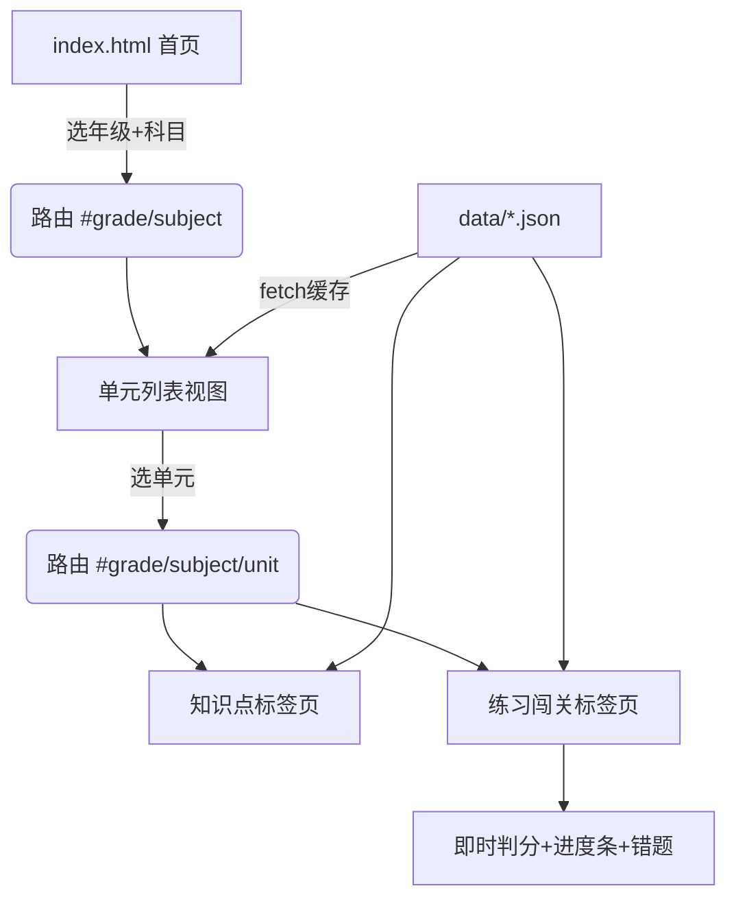

## 用户需求

为广州地区小学生设计一个「小学知识训练营」网页，覆盖语文、数学、英语三科，对应人教版课本，先完成一至三年级上学期内容。

## 产品概述

纯静态网页，数据驱动。首页以广州地域风格呈现，提供年级（一/二/三年级）与科目（语文/数学/英语）选择入口；进入后按单元展示课本知识点，并配可评分的在线练习闯关，体验类似学习小程序。

## 核心功能

- 首页：广州主题封面 + 年级/科目入口卡片
- 单元列表：展示该年级科目全部单元（样例单元含内容，其余占位）
- 知识点展示：单元内课文/生字词/公式/单词等图文卡片
- 练习闯关：选择题、填空题等互动练习，做题即时判分
- 学习反馈：单元进度条、错题收集与讲解
- 响应式：桌面与移动端自适应，大字号适合小学生

## 技术栈选择

- 纯静态站点：HTML + CSS + 原生 JavaScript（无构建、双击即开、易分享维护）
- 内容数据：9 个 JSON 文件（data/g{1,2,3}_{yuwen,shuxue,yingyu}.json），与界面解耦
- 路由：原生 hash 路由（#grade/subject/unit），无第三方依赖
- 存储：示例阶段用内存状态；预留 localStorage 接口用于错题本

## 实现方案

采用「数据驱动 + 组件化渲染」策略：所有课本内容以 JSON 描述，前端按统一模板渲染知识点卡片与练习组件，新增内容只改数据不改代码。纯前端 hash 路由串联 首页→选科→单元列表→知识点/练习 四个视图，避免页面刷新。

关键技术决策：

1. 分科分年级数据文件而非单一大文件，降低单文件体积、便于按模块补全与维护（YAGNI/SoC）。
2. 练习题型抽象为统一结构 {type, question, options, answer, explain}，render.js 按 type 分发渲染，新增题型仅需扩展渲染分支（开闭原则）。
3. 评分逻辑集中在 render.js 的 checkAnswer，避免散落；错题以 (grade,subject,unit,exerciseId) 为键收集。
4. 英语版本字段 edition 区分「一年级起点」与「PEP 三年级起点」，由数据驱动展示，无需分支代码。

性能与可靠性：内容为静态 JSON，总量小（9 文件，每文件数十 KB），fetch 后缓存于内存，单元切换不重复请求；渲染仅操作当前视图 DOM，避免整页重绘。占位单元在数据中标 placeholder:true，render 时显示「敬请期待」占位卡，保证框架完整且零报错。

## 实现注意

- 复用统一 card/section 样式类，避免重复 CSS；占位单元与真实单元共用列表渲染，靠 placeholder 字段区分。
- 练习判分只比对规整化后的答案（去空格/大小写），并展示 explain 降低挫败感。
- 不做无关重构；所有新文件集中在 index.html、css/、js/、data/ 之下，保持目录扁平。

## 架构设计



## 目录结构

```
f:/CodeBuddy/PSKTC/
├── index.html                    # [NEW] 首页骨架：广州主题封面 + 年级/科目选择卡片；挂载视图容器
├── css/
│   └── style.css                 # [NEW] 全局样式：童趣明快配色、卡片/标签页/进度条、移动端自适应
├── js/
│   ├── app.js                    # [NEW] hash 路由与状态管理：解析路由、加载对应 JSON、调度渲染
│   └── render.js                 # [NEW] 渲染层：单元列表、知识点卡片、练习组件(checkAnswer 判分)、错题收集
└── data/
    ├── g1_yuwen.json             # [NEW] 一年级上册语文：全部单元框架 + 第一单元识字/汉语拼音样例
    ├── g1_shuxue.json            # [NEW] 一年级上册数学：框架 + 准备课/1~5加减样例
    ├── g1_yingyu.json            # [NEW] 一年级起点英语：框架 + Unit1 School/Unit3 Animals 样例
    ├── g2_yuwen.json             # [NEW] 二年级上册语文：框架 + 第一单元课文/识字样例
    ├── g2_shuxue.json            # [NEW] 二年级上册数学：框架 + 长度单位/100内加减样例
    ├── g2_yingyu.json            # [NEW] 一年级起点英语：框架 + Unit1/Unit2 样例
    ├── g3_yuwen.json             # [NEW] 三年级上册语文：框架 + 学校生活/金秋时节样例
    ├── g3_shuxue.json            # [NEW] 三年级上册数学：框架 + 测量/时分秒样例
    └── g3_yingyu.json            # [NEW] PEP 三年级起点英语：框架 + Unit1 Hello/Unit3 样例
```

## 关键数据结构

```
{
  "grade": 1, "subject": "yuwen", "edition": "统编/人教", "title": "一年级上册 语文",
  "units": [
    { "id": "u1", "name": "第一单元 识字",
      "knowledge": [ {"title": "天地人", "content": "...", "type": "text"} ],
      "exercises": [ {"type": "choice", "question": "", "options": [], "answer": "", "explain": ""} ] },
    { "id": "u2", "name": "第二单元（占位）", "knowledge": [], "exercises": [], "placeholder": true }
  ]
}
```

## 设计风格

采用「童趣明快 + 广州地域」风格：以木棉花橙红与珠江蓝为主色调，首页用简笔小蛮腰（广州塔）与木棉花点缀，营造亲切的本地化学习氛围。卡片化布局、大圆角、柔和阴影，适合小学生；交互加入悬停微动效与答题正确/错误的色彩反馈。

## 页面规划（不超过 5 屏）

- 首页：顶部品牌区（广州塔简笔 + 标题）、年级选择卡片（一/二/三）、科目选择卡片（语/数/英），点击组合进入。
- 单元列表页：返回首页、标题、单元卡片纵向排列，占位单元显示「敬请期待」灰卡。
- 单元详情页：顶部标签切换「知识点 / 练习闯关」，知识点为卡片流；练习页为逐题卡片 + 进度条 + 提交判分。

## 单页区块（单元详情为例）

- 顶部导航：返回按钮 + 年级科目标题，常驻全站。
- 标签栏：知识点 / 练习闯关 两标签页切换。
- 知识点区：课文/生字/公式卡片，图文混排，大字号。
- 练习区：题目卡片、选项按钮、进度条、对错即时反馈与解析。
- 底部：学习进度与错题提示条，常驻。